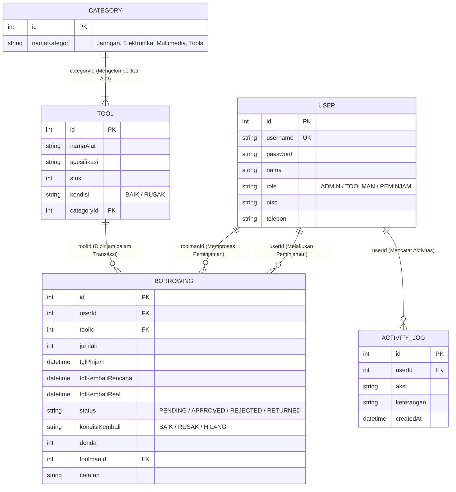

# 🔬 SISTEM PEMINJAMAN SARPRAS LAB RPL & ELEKTRONIKA
### Aplikasi Inventaris & Sirkulasi Peralatan Praktikum Laboratorium Komputer
**Standar Uji Kompetensi Keahlian (UKK) & Standar Industri — SMK Telkom**

Aplikasi web *server-side* berbasis **Node.js, Express.js MVC, EJS (Clean Modern Light Dashboard dengan Tailwind CSS), dan Prisma ORM dengan SQLite**. Sistem ini mendigitalkan seluruh siklus pengelolaan sarana dan prasarana laboratorium komputer dan elektronika (kabel LAN tester, crimping tool, router Mikrotik, proyektor, solder, multimeter, kit Arduino) dengan otentikasi **Role-Based Access Control (RBAC) 3 Level**.

---

## 🎯 Latar Belakang Masalah di Sekolah & Solusi Sistem

### Masalah di Laboratorium:
1. **Peralatan Sering Tercecer & Hilang:** Tanpa sistem pencatatan digital, toolman lab kesulitan melacak siapa siswa terakhir yang meminjam alat praktikum.
2. **Kondisi Fisik Alat Tidak Terpantau:** Alat sering dikembalikan dalam keadaan rusak (misal: port patah, mata solder lecet, kabel putus) tanpa ada pihak yang bertanggung jawab.
3. **Pencatatan Denda & Ganti Rugi Manual:** Kas denda kerusakan atau penggantian barang sering tercecer dan tidak memiliki bukti berita acara yang sah.
4. **Stok Riil Tidak Terintegrasi:** Siswa sering berebut alat karena ketersediaan stok di lab tidak bisa dipantau secara langsung.

### Solusi Sistem:
- 🛡️ **Pencatatan Berjenjang (RBAC 3 Level):** Pemisahan tugas yang jelas antara Kepala Lab (Admin), Toolman/Laboran, dan Siswa/Guru (Peminjam).
- ⚡ **Atomic Stock Management:** Stok alat di rak lab otomatis dipotong saat Toolman menyetujui peminjaman, dan otomatis dikembalikan saat alat selesai diinspeksi.
- 🔍 **Inspeksi Fisik & Perhitungan Denda:** Toolman wajib memeriksa kondisi fisik alat saat pengembalian (BAIK / RUSAK / HILANG) dan menginput nominal denda jika ditemukan kerusakan.
- 🖨️ **Cetak Berita Acara & Laporan Resmi:** Dilengkapi fitur cetak dokumen resmi ber-kop surat sekolah dengan kolom tanda tangan digital antara Toolman dan Kepala Lab.
- 📜 **Audit Log Sirkulasi Otomatis:** Setiap aktivitas login, penambahan inventaris, approval, penolakan, hingga inspeksi fisik tersimpan dalam rekam jejak audit trail yang tidak dapat dimanipulasi.

---

## 🏗️ Tech Stack & Arsitektur Sistem

- **Runtime:** Node.js (v18+ / v20+ LTS / v24)
- **Framework Backend:** Express.js (Arsitektur MVC: *Controllers, Models, Routes, Views, Middlewares, Helpers*)
- **Database:** SQLite (Mandiri dalam 1 file `prisma/dev.db` — *Zero-Config*, tanpa perlu XAMPP / MySQL)
- **Object-Relational Mapping (ORM):** Prisma ORM (`@prisma/client` v6+)
- **View Engine:** EJS (*Embedded JavaScript*)
- **Styling UI/UX:** Tailwind CSS modern (*Clean Light Dashboard Theme*), Google Fonts (Plus Jakarta Sans), FontAwesome 6 Icons, CSS Print Stylesheet
- **Autentikasi & Keamanan:** Session-based Authentication (`express-session`), Password Hashing (`bcryptjs`), RBAC Authorization Middleware (403 Forbidden Protection)

---

## 👥 3 Level Pengguna (Role-Based Access Control)

| Peran (Role) | Target Pengguna | Tanggung Jawab & Hak Akses |
| :--- | :--- | :--- |
| **ADMIN** | Kepala Lab Komputer / IT | CRUD Pengguna, CRUD Kategori, CRUD Inventaris Alat, CRUD Transaksi Peminjaman, dan Memantau Audit Log Sirkulasi. |
| **TOOLMAN** | Toolman / Laboran Lab | Memverifikasi persetujuan (Approval) pinjaman, memantau alat di lapangan, inspeksi kondisi fisik (Baik/Rusak/Hilang), input denda, dan mencetak Berita Acara Laporan. |
| **PEMINJAM** | Siswa & Guru Kejuruan | Melihat katalog ketersediaan stok riil lab, mengajukan permohonan pinjam alat, dan konfirmasi pengembalian alat ke meja Toolman. |

---

## 📋 Matriks 13 Fitur Wajib

| No | Fitur Sistem | Target Role | Rute / Controller |
| :---: | :--- | :--- | :--- |
| 1 | **Login & Logout Multi-Role** | Admin, Toolman, Peminjam | `/login`, `/logout`, `/login/demo/:role` |
| 2 | **CRUD Data Pengguna (User)** | Admin | `GET/POST /users/*` |
| 3 | **CRUD Inventaris Alat Praktikum** | Admin | `GET/POST /tools/*` |
| 4 | **CRUD Kategori Alat Lab** | Admin | `GET/POST /categories/*` |
| 5 | **CRUD Data Peminjaman & Sirkulasi** | Admin | `GET/POST /borrowings/*` |
| 6 | **Log Aktifitas Sistem Laboratorium** | Admin | `GET /logs` |
| 7 | **Menyetujui (Approval) Peminjaman Alat** | Toolman | `POST /borrowings/:id/approve` |
| 8 | **Memantau & Memproses Pengembalian** | Toolman | `GET/POST /borrowings/*` |
| 9 | **Pemeriksaan Fisik & Input Denda Rusak** | Toolman | `POST /borrowings/:id/return` |
| 10 | **Mencetak Laporan Peminjaman (PDF/Print)** | Toolman & Admin | `GET /reports/print` |
| 11 | **Melihat Daftar & Ketersediaan Stok Alat** | Peminjam | `GET /catalog` |
| 12 | **Mengajukan Peminjaman Alat Praktikum** | Peminjam | `POST /borrowings/submit` |
| 13 | **Mengembalikan Alat ke Meja Toolman** | Peminjam | `POST /borrowings/:id/notify-return` |

---

## 📊 Rancangan Skema Database (Prisma ORM)



---

## 🔑 Kredensial Akun Pengujian (Demo Accounts)

Semua akun menggunakan password standar: **`password123`**.

| Role | Username | Password | Nama Pengguna | Tugas & Hak Akses |
| :--- | :--- | :--- | :--- | :--- |
| **ADMIN** | `admin` | `password123` | Budi Santoso, S.Kom | Kepala Lab IT (Super Admin) |
| **TOOLMAN** | `toolman` | `password123` | Ahmad Rizky | Toolman / Laboran Lab |
| **PEMINJAM** | `peminjam` | `password123` | Muhammad Fajar | Siswa XII RPL 1 (Peminjam) |
| **PEMINJAM** | `guru_rpl` | `password123` | Dian Pratama, S.Pd | Guru Produktif RPL |

> **Fitur Praktis:** Di halaman login (`/login`) tersedia tombol **"Fast Switch Demo Login (1-Klik)"** untuk Admin, Toolman, dan Peminjam sehingga penguji dapat berpindah peran secara instan.

---

## 🚀 Panduan Menjalankan Aplikasi

### 1. Inisialisasi Dependensi
```bash
npm install
```

### 2. Konfigurasi Environment (`.env`)
Salin berkas `.env.example` menjadi `.env`:
```env
PORT=3000
DATABASE_URL="file:./dev.db"
SESSION_SECRET="sarpras-lab-rpl-smk-telkom-2026"
```

### 3. Migrasi Database SQLite (Prisma)
```bash
npx prisma db push
```

### 4. Populasi Data Awal (Seeding)
```bash
node prisma/seed.js
```

### 5. Menjalankan Server Aplikasi
```bash
# Mode Development (Auto Reload dengan nodemon)
npm run dev

# Atau Mode Standar Node.js
node src/server.js
```

Buka peramban (browser) di alamat: **`http://localhost:3000`**

---

## 🧪 Verifikasi 5 Skenario Pengujian Wajib (`TEST_CASES.md`)

Seluruh skenario pengujian industri telah diverifikasi dan **LULUS 100%**:

1. **Login User Sesuai Hak Akses (RBAC):** Otentikasi session bekerja presisi; upaya akses tanpa izin langsung dicegah dengan halaman respons **403 Forbidden**.
2. **Admin Menambah Inventaris Baru:** Admin berhasil menambahkan *Mikrotik RouterBoard stok 5 unit* ke inventaris dan tercatat di Audit Log.
3. **Siswa Mengajukan Peminjaman:** Siswa memilih alat dari katalog dan mengajukan 1 unit Mikrotik dengan status awal **PENDING**.
4. **Toolman Menyetujui Peminjaman:** Toolman menyetujui permohonan pinjam; status transaksi menjadi **APPROVED** dan stok alat di lab **otomatis berkurang dari 5 menjadi 4 unit**.
5. **Pengembalian Alat Rusak & Denda:** Toolman melakukan inspeksi fisik saat alat diserahkan, mencatat kondisi **RUSAK**, menginput nominal denda kerusakan, dan transaksi tercatat lengkap pada **Audit Log** serta **Berita Acara Cetak Laporan**.

Dokumentasi lengkap skenario pengujian tersedia di berkas [`TEST_CASES.md`](./TEST_CASES.md).

---

## 📁 Struktur Berkas Lengkap

```
├── prisma/
│   ├── schema.prisma              # Definisi 5 Model Database
│   ├── seed.js                    # Seeder Akun Demo & Master Data
│   └── dev.db                     # Berkas Database SQLite
├── src/
│   ├── config/db.js               # Inisialisasi Prisma Client
│   ├── controllers/
│   │   ├── auth.controller.js      # Kontroler Otentikasi & Demo Login
│   │   ├── dashboard.controller.js # Kontroler Dashboard 3 Role
│   │   ├── user.controller.js      # CRUD Master Pengguna
│   │   ├── category.controller.js  # CRUD Master Kategori Alat
│   │   ├── tool.controller.js      # CRUD Inventaris Alat & Katalog
│   │   ├── borrowing.controller.js # Sirkulasi Peminjaman & Inspeksi Denda
│   │   ├── report.controller.js    # Rekapitulasi & Cetak Dokumen Resmi
│   │   └── log.controller.js       # Audit Log Sirkulasi Laboratorium
│   ├── helpers/
│   │   └── activityLog.js         # Helper Pencatatan Audit Trail
│   ├── middlewares/
│   │   └── auth.middleware.js     # Middleware Otentikasi & RBAC Guard
│   ├── routes/                    # Modul Rute Express Terpisah
│   └── server.js                  # Entry Point Aplikasi Web Express
├── views/
│   ├── auth/login.ejs             # Halaman Login & Fast Switch Demo
│   ├── dashboard/                 # Tampilan Dashboard Spesifik Role
│   ├── users/                     # Tampilan CRUD Pengguna
│   ├── categories/                # Tampilan CRUD Kategori
│   ├── tools/                     # Tampilan Inventaris & Katalog Stok
│   ├── borrowings/                # Tampilan Sirkulasi & Modal Inspeksi
│   ├── reports/                   # Tampilan Filter Laporan & Cetak Resmi
│   ├── logs/                      # Tampilan Audit Trail Laboratorium
│   ├── errors/                    # Halaman 403, 404, 500
│   └── partials/                  # Header (Navigasi Dinamis) & Footer
├── TEST_CASES.md                  # Laporan Hasil 5 Skenario Uji
└── package.json                   # Konfigurasi Dependensi Proyek
```

---

*Dikembangkan untuk standar Uji Kompetensi Keahlian (UKK) Rekayasa Perangkat Lunak & Elektronika — SMK Telkom Lampung.*
